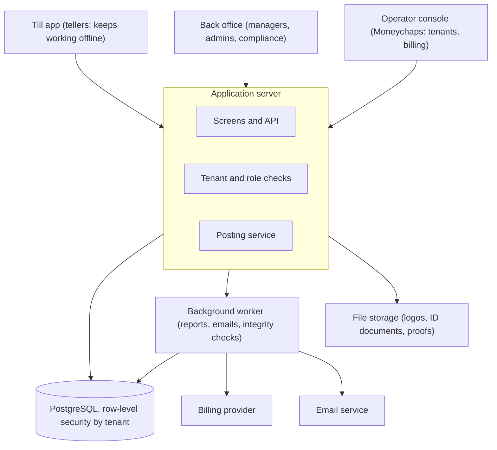

# Fxchange Rebuild Blueprint

Version of 16 November 2026 · Owner: Thabiso Mabaka, Moneychaps (Pty) Ltd

## 1. Purpose of this blueprint

This document specifies Fxchange completely enough to rebuild it on a scalable platform with Claude Code, without access to the Zoho Creator app. It records what the system does and the rules it enforces, not the Deluge code that currently implements them.

It was written from two sources: the Zoho Creator application export (`.ds` file) and the build history of the features added after that export. It was checked against the export of 16 November 2026; section 17 records what that check found.

**How to use it with Claude Code**

1. Put this document in the new repository as `docs/blueprint.md` (export it from here as Markdown).
2. Build one phase at a time, in the order given in section 16. Ask Claude Code to read the relevant sections before each phase.
3. Treat every numbered rule as a requirement, and every acceptance test in section 16 as a test that must pass before the phase is done.
4. When a rule here conflicts with a simpler implementation, keep the rule. Most of them exist because of a control, an audit or a regulatory need.

**Conventions**

- BWP (Botswana pula) is the base currency. All ledger values are in BWP.
- "Tenant" means one bureau de change business. "Branch" means one licensed outlet of a tenant.
- "Void" always means reversal by a contra entry. Nothing financial is ever deleted or edited in place.

## 2. Product overview

Fxchange is a multi-tenant point-of-sale and back-office system for licensed bureaux de change in Botswana, sold as a subscription by Moneychaps (Pty) Ltd. Each tenant runs its branches, tills, currency stock, customers, books and Bank of Botswana returns in one system.

**What a tenant does in the system**

| Area | What it covers |
| --- | --- |
| Trading | Buy and sell foreign currency against pula at the counter, with rates, approvals, voids and printed receipts |
| Tills and cash | Till sessions, floats, top-ups, vault, bank accounts, cash counts and variances |
| Currency stock | Stock per branch and currency, valued by FIFO or weighted average, with cost of sales and profit per sale |
| Customers | KYC records for individuals and entities, risk profile, PEP flag, blocking |
| Accounts | Supplier bills, payments and receipts, journals, loans, opening balances, a general ledger |
| Reporting | End of Day report, Income and Expense Summary, Bank of Botswana Form 5 monthly return |
| Administration | Branches, staff, roles, company details, subscription status |

**Regulatory context that shapes the design**

- Bureaux are licensed per branch by the Bank of Botswana (BoB). The monthly return (Form 5) is prepared per branch.
- Customer identification, source of funds above a threshold, risk rating and politically exposed person (PEP) flags come from anti-money-laundering obligations under the Financial Intelligence Agency (FIA).
- Every financial record must be traceable: who captured it, when, and how it was corrected. This is why nothing is deleted and corrections are reversals.
- Tenants hold personal data of their customers, so each tenant signs a data processing agreement, and tenant data must be strictly isolated.

## 3. Why rebuild, and what the new platform must achieve

The Zoho Creator build proves the product, but its design cannot carry many tenants. The limits below were met during the build; the record cap for the current Creator plan should be confirmed on the Creator billing page, because the public pricing page does not state it.

| Limit in the current build | Why it blocks scale |
| --- | --- |
| All tenants share one set of tables, capped by the plan's record allowance | Every tenant's transactions, ledger rows and GL lines count against one total |
| A script can fetch at most 1,000 rows | Reports and balances that read a month of activity silently truncate |
| Cash balance is recalculated by summing every ledger row for the account | Each posting gets slower as history grows |
| Receipt and reference numbers are found by scanning all earlier records | Slow, and two tellers posting together can collide |
| Postings are several separate writes with no database transaction | A failure part-way leaves cash, stock and ledger out of step |
| Tenant isolation depends on a text field of emails matched by "contains" | Fragile, and it forces a rule that no email may be a substring of another |
| Portal users and cloud function calls are priced and capped per plan | Cost and limits grow with every teller added |
| No offline operation in the browser portal | Branches cannot trade through a connection outage |

**Goals for the rebuild**

1. Hold hundreds of tenants and tens of millions of transactions without redesign.
2. Make every posting atomic: cash, stock, receipt number and ledger commit together or not at all.
3. Enforce tenant isolation in the database, not in application code alone.
4. Keep every business rule in this blueprint, including the audit trail.
5. Allow a till to keep trading through a connection outage (section 14).
6. Bring foreign exchange trading into the general ledger, so a trial balance balances (section 10).

Sources: [Zoho Creator pricing](https://www.zoho.com/creator/pricing.html), [Understanding offline access](https://help.zoho.com/portal/en/kb/creator/developer-guide/mobile/articles/understanding-offline-access).

## 4. Roles and permissions

Fxchange has five tenant roles plus the platform operator. A staff member has exactly one role. Teller, Supervisor and Branch Manager belong to one branch; Tenant Admin and Compliance Officer are tenant-wide and have no branch.

**Record access by role** (A = add, V = view, E = edit; a dash means no access; nobody can delete)

| Record | Teller | Supervisor | Branch Manager | Tenant Admin | Compliance Officer |
| --- | --- | --- | --- | --- | --- |
| Transactions | A V | A V E | A V E | A V E | V |
| Customers | A V E | A V E | A V E | A V E | V E |
| Till sessions | A V E | A V E | A V E | A V E | V |
| Cash transfers | V | V | A V | A V | V |
| Exchange rates | V | V | A V E | A V E | V |
| Payments and receipts | — | A V | A V E | A V E | V |
| Bills, suppliers | — | V | A V E | A V E | V |
| Cash accounts | V | V | A V E | A V E | V |
| Cash ledger, currency holdings | V | V | V | V | V |
| Currency batches and consumptions | — | V | V | V | V |
| Currencies traded, transaction purposes | V | V | V | A V E | V |
| Chart of accounts (categories) | — | — | V | A V E | V |
| Journals, loans, opening balances | — | — | — | A V E | V |
| General ledger | — | — | — | V | V |
| Staff, branches | — | — | V | A V E | V |
| Company details | — | — | — | V E | V |
| Compliance access grants | — | — | — | A V E | — |

**Action rules that the table does not show**

1. A Teller records transactions only on their own open till session. A Supervisor or Branch Manager records only on sessions at their own branch. A Tenant Admin can record on any session. A Compliance Officer cannot record transactions.
2. A rate override by a Teller or Supervisor goes to Pending Approval. A Branch Manager, Tenant Admin or Compliance Officer approves or rejects it. A Branch Manager or Tenant Admin overriding their own rate is approved at once.
3. Any staff member of the tenant with an open till at the transaction's branch can void a completed transaction; a void reason is required.
4. Only a Branch Manager or Tenant Admin moves cash (floats, top-ups, bank deposits and withdrawals). Only a Tenant Admin moves cash between branches.
5. A Branch Manager sets rates for their own branch only. A Tenant Admin sets business-wide and branch rates.
6. A Supervisor can capture payments and receipts but cannot void them. A Branch Manager can void bills and payments of their own branch. A Tenant Admin can void any.
7. On customers, a Teller cannot change risk profile, PEP flag, KYC status or account status after creation. A Compliance Officer can change only those four fields and cannot add customers. Only a Branch Manager or Tenant Admin can change an ID number. Customer type and customer number never change.
8. A Tenant Admin can edit company details except company name, BoB licence number and company registration number. Subscription, billing, limits and sequence fields are changed only by the platform operator.
9. Journals, loans, opening balances and the opening trial balance are Tenant Admin only.
10. A Compliance Officer of one tenant can be granted read access to another tenant by that tenant's Admin (a compliance access grant). The grant can be revoked, and its email cannot be changed.

**Platform operator (Moneychaps).** Creates tenants, sets subscription status, plan, branch and seat limits, and maintains the shared masters: currencies, customer natures, risk profiles and the compliance threshold. In the rebuild this is a separate operator console with its own login, not a tenant role.

Tenant-configurable access rights (letting a Tenant Admin adjust what each role may do) are planned for after the pilot. Build the permission checks behind one policy module so this can be added without touching each feature.

## 5. Tenancy, subscription and onboarding

Every business record belongs to exactly one tenant, and a user can only ever see or change their own tenant's records. The shared masters in section 6 are the only data common to all tenants.

**Identity**

1. A user signs in with an email. The email matches one active staff record, which gives the tenant, role and branch. An email belongs to one staff record across the whole platform.
2. A staff record with status Suspended cannot sign in. Reactivating it restores access.
3. Adding a staff member invites them and gives them the profile for their role. Changing the role changes their access at the next sign-in.
4. Staff seats are limited per tenant (staff seat limit counts active staff). Branches are limited per tenant (branch limit counts branches that are not Closed). A blank limit means unlimited.

**Subscription status**

| Tenant status | Effect |
| --- | --- |
| Trial | Full access. If a trial end date is set and has passed, blocked |
| Active, or blank | Full access |
| Grace Period | Full access with a warning that names the cut-off date. Blocked once the grace period end date has passed |
| Suspended | Blocked, with a message that says the subscription is suspended |
| Cancelled | Blocked, with a message that says the subscription is cancelled |

"Blocked" means no new entries of any kind. Staff can still sign in, view existing records and export them, so a tenant never loses sight of its own data.

A branch has its own status (Active, Grace Period, Suspended, Closed) with the same meaning for staff tied to that branch. Tenant-wide roles are not blocked by one branch's status. Blocked users must see the real reason, not a generic "not linked" message. Tenants cannot change their own or their branches' status.

Data is never removed when a subscription lapses. A pilot tenant keeps all its data when billing starts.

**Plans and billing** (adopted model, run through Zoho Billing)

1. Charge a flat monthly subscription per tenant that includes one branch and a set number of staff seats, plus an add-on per extra branch and an add-on per extra staff seat. The Creator build already carries the fields for this: branch limit, staff seat limit, and the extra-branch and extra-seat markers.
2. Do not charge per transaction. Bureaux work on thin margins and need a predictable cost, and per-transaction fees penalise the busiest clients.
3. Bill in pula, monthly or annually in advance, with a discount for annual payment.
4. Limits a plan enforces: branches, staff seats, and file storage for ID documents. Transactions, customers, currencies and reports are unlimited on every plan.
5. Life cycle: a free trial with an end date; Active on first payment; Grace Period for a fixed number of days after a failed or missed payment, with a warning banner; then Suspended, which blocks new entries but keeps all data readable; Cancelled on request.

The adopted plan structure, with prices still to be set by the product owner:

| Plan | Branches included | Staff seats included | Add-ons |
| --- | --- | --- | --- |
| Single | 1 | 5 | Extra seat |
| Multi-branch | 3 | 15 | Extra branch, extra seat |
| Enterprise | By agreement | By agreement | Custom terms, dedicated support |

The closest published comparison is CurrencyXchanger, a currency exchange system listed from US$120 a month for its basic plan; most other bureau systems price on request.

**Zoho Billing fit and limits.** In Zoho Billing each plan above is a plan, and extra branch and extra seat are add-ons with a quantity. Its events (subscription activated, payment failed, cancelled) drive `subscription_status` through webhooks. At the time of writing its Standard plan is listed at US$50 a month with 3 users, 100,000 invoices a year, a US$1 million annual billed amount and 500 webhooks a day; Premium is US$100 a month with 10 users and higher automation limits. Standard is enough to start. Before committing, check on a trial account that it invoices in pula and that a payment gateway available to a Botswana business is supported; if not, record bank transfers manually against invoices.

Sources: [Zoho Billing plan comparison](https://www.zoho.com/billing/pricing-comparison/), [CurrencyXchanger pricing on G2](https://www.g2.com/products/clear-view-systems-currencyxchanger/pricing).

**Onboarding a tenant** (one operator action, safe to run twice)

1. **Tenant defaults.** If the receipt prefix is blank, set it to the first three letters of the company name in capitals (or FXC). If the subscription status is blank, set it to Trial. Stamp the onboarded date.
2. **Chart of accounts.** Seed the accounts listed in section 10, skipping any name that already exists.
3. **Transaction purposes.** Travel / Holiday; Business / Trade; Education / School Fees; Medical Treatment; Family Support / Gifts; Investment; Personal Use; Other.
4. **Currencies.** Pula as the base currency, plus each requested code found in the shared currency list, with 2 decimal places. A code not in the shared list is reported, not created.
5. **First branch.** Created as head office with code BR1, its licence reference, address and phone, status Active.
6. **Cash accounts.** One vault named "\<branch> Vault" and the requested number of tills named "\<branch> Till 1", "Till 2" and so on, up to 10.
7. **Tenant Admin.** A staff record with the Tenant Admin role, refused if that email already belongs to staff of another tenant, followed by the invitation.
8. The operator receives a log of every step, including what was skipped.

Running it again for the same tenant must skip everything that already exists.

**Opening position.** After onboarding, the Tenant Admin enters opening cash and currency balances, then the opening trial balance for other accounts (section 10).

## 6. Data model

The model has 33 entities in six groups. Every tenant-owned entity carries `tenant_id`; most also carry `branch_id`. Names below are the suggested table names for the rebuild; the Creator form name is in brackets where it differs in more than case.

All entities also need `id`, `created_at`, `created_by` and, where rows are corrected by reversal, no `updated_at` on the financial columns.

**Platform and shared masters** (no tenant; maintained by the operator)

| Entity | Fields |
| --- | --- |
| `currencies` | code (ISO 4217, unique), name, symbol, is\_active |
| `customer_natures` | name, is\_institutional, is\_active, return\_category (Public, Bank or Bureau de Change) |
| `risk_profiles` | name (unique), risk\_level (Low, Medium, High), description, sort\_order, is\_active |
| `compliance_settings` | source\_of\_funds\_threshold\_bwp (currently 10,000). One platform value, set by the operator |

**Tenant setup**

| Entity | Fields |
| --- | --- |
| `tenants` | company\_name, trading\_name, bob\_licence\_number, company\_reg\_number, physical\_address, contact\_person, contact\_email, contact\_phone, logo, receipt\_prefix, receipt\_footer\_text, financial\_year\_start\_month, valuation\_method (FIFO, Weighted Average), dpa\_signed, dpa\_signed\_date, billing\_currency, subscription\_plan, branch\_limit, staff\_seat\_limit, billing\_customer\_id, billing\_subscription\_id, subscription\_status, trial\_end\_date, grace\_period\_end\_date, onboarded\_date |
| `branches` | name, code, address, phone, email, licence\_reference, is\_head\_office, is\_extra\_branch, status, grace\_period\_end\_date |
| `staff` | full\_name, email (unique platform-wide), employee\_id, phone, role, branch\_id (null for tenant-wide roles), daily\_transaction\_limit\_bwp, status (Active, Suspended), is\_extra\_seat, last\_login, tipping\_off\_acknowledged\_on |
| `compliance_access_grants` \[Tenant\_Access\_Grants\] | grantee\_email, status (Active, Revoked), granted\_by, granted\_at, revoked\_by, revoked\_at |
| `tenant_currencies` \[Currency\_Stock\_Items\] | currency\_id, is\_base\_currency, decimal\_places, low\_stock\_alert\_level, is\_active, date\_added |
| `transaction_purposes` | name, is\_active |
| `cash_accounts` | branch\_id, name, type (Till, Vault, Bank Account, Settlement Account), fixed\_currency\_id (bank and settlement accounts), bank\_name, account\_number, status (Active, Closed) |

**Trading**

| Entity | Fields |
| --- | --- |
| `exchange_rates` | currency\_id, branch\_id (null = business-wide), effective\_from, effective\_to, buy\_rate, sell\_rate, set\_by |
| `customers` | customer\_number, type (Individual, Entity), nature\_id, full\_name, id\_type (Omang, Passport, Company Registration), id\_number, id\_expiry, address, phone, email, tax\_id, licence\_number, risk\_profile\_id, pep\_flag, id\_document, kyc\_status, account\_status, date\_of\_birth, nationality, residency\_status, occupation, date\_of\_incorporation, country\_of\_incorporation, nature\_of\_business, contact\_person, beneficial\_owners, directors\_trustees |
| `transactions` | branch\_id, till\_session\_id, teller\_id, type (Buy, Sell), mode (Cash, Bank Transfer, Mobile Money, Card), currency\_id, customer\_id, quantity, system\_rate, rate\_applied, base\_currency\_amount, is\_rate\_override, rate\_override\_reason, approved\_by, approved\_at, purpose\_id, source\_of\_funds, cash\_account\_id, settlement\_account\_id (non-cash modes), receipt\_number, status (Pending Approval, Completed, Voided, Rejected), void\_reason, voided\_by, voided\_at, rejection\_reason, rejected\_by, rejected\_at, transaction\_datetime, cost\_of\_currency\_sold, profit\_bwp |

**Tills and cash**

| Entity | Fields |
| --- | --- |
| `till_sessions` | branch\_id, till\_id, teller\_id, opened\_by, opening\_datetime, closing\_datetime, status (Awaiting Float, Open, Closed), variance\_note, closed\_by, session\_label |
| `till_session_balances` | session\_id, currency\_id, system\_balance, counted\_balance, variance |
| `cash_transfers` | branch\_id, type (Float Issue, Top Up, Bank Deposit, Bank Withdrawal, Bank Transfer, Branch Transfer), till\_session\_id, from\_account\_id, to\_account\_id, currency\_id, amount, reference, notes, issued\_by, issued\_at |
| `cash_ledger` | branch\_id, cash\_account\_id, currency\_id, direction (In, Out), amount, balance\_after, source\_type (Transaction, Cash Transfer, Adjustment, Opening Balance, Reversal, Payment, Receipt), source\_ref, till\_session\_id, moved\_at |

**Currency stock**

| Entity | Fields |
| --- | --- |
| `currency_holdings` | branch\_id, currency\_id, qty\_on\_hand, weighted\_avg\_cost, stock\_value\_bwp, last\_movement. One row per branch and currency |
| `currency_batches` | branch\_id, currency\_id, batch\_date, source\_type (Buy, Transfer In, Adjustment In, Opening Balance, Void Reversal), source\_ref, qty\_purchased, cost\_rate\_bwp, remaining\_qty, is\_exhausted |
| `currency_batch_consumptions` | batch\_id, transaction\_receipt, qty\_consumed, cost\_rate, reversed, reversed\_at |

**Accounts**

| Entity | Fields |
| --- | --- |
| `accounts` \[Cash\_Categories\] | name, group (Operating Expense, Other Income, Assets, Liabilities, Current Payables & Accruals, Equity), direction (Payment, Receipt, Both), is\_active, is\_system, sub\_ledger (None, Loans, Suppliers) |
| `suppliers` | name, contact\_person, phone, email, address, is\_active |
| `bills` | reference, supplier\_id, supplier\_invoice\_no, bill\_date, due\_date, branch\_id (null = not branch specific), total, amount\_paid, balance\_due, status (Unpaid, Part Paid, Paid, Overpaid, Voided), attachment, notes, void fields |
| `bill_lines` | bill\_id, account\_id, description, amount |
| `payments_receipts` | branch\_id, entry\_type (Payment, Receipt), pay\_against (Bill, General Ledger, Supplier Advance), supplier\_id, bill\_id, linked\_ref\_type, linked\_ref\_id, entry\_date, cash\_account\_id, currency\_id, amount, bwp\_equivalent, account\_id, payee\_payer, description, proof, reference, status (Posted, Voided), void fields |
| `journals` | reference, journal\_date, branch\_id (null = not branch specific), narration, total\_debit, total\_credit, status (Posted, Voided), void fields |
| `journal_lines` | journal\_id, account\_id, linked\_ref\_type, linked\_ref\_id, description, debit, credit |
| `loans` \[Loan\_Form\] | reference, lender\_name, lender\_type (Bank, Shareholder, Director, Related Party), currency\_id, start\_date, maturity\_date, repayment\_frequency, status (Active, Settled, Written Off), agreed\_amount, amount\_received, interest\_charged, total\_repaid, outstanding\_balance, agreement, notes |
| `opening_balances` | reference (OB-0001), as\_at\_date, cash\_account\_id, currency\_id, amount, cost\_rate\_bwp, bwp\_value, notes, status (Posted, Voided), void fields |
| `opening_trial_balance` and `opening_trial_balance_lines` | header: as\_at\_date, status (Draft, Posted), finalised, posted\_ref, post\_version, totals. Lines: account\_id, supplier\_id, loan\_id, description, debit, credit. One per tenant |
| `gl_entries` | branch\_id, entry\_date, account\_id or cash\_account\_id (exactly one), debit, credit, source\_type (Bill, Bill Payment, Payment, Receipt, Journal, Opening Balance, Void, and in the rebuild FX Buy, FX Sell), source\_ref, bill\_id, description, posted\_at, ref\_type, ref\_id |

**Rules for the rebuild's schema**

1. Money and quantities are fixed-point decimals, never floating point. Rates need at least 6 decimal places.
2. `cash_ledger`, `gl_entries`, `currency_batch_consumptions` and all void fields are append-only. Enforce this in the database, not only in the application.
3. Sequences (receipt numbers, customer numbers, OB, JNL, OTB references) come from a per-tenant counter table updated inside the posting transaction.
4. The Creator fields `Portal_Emails`, `Portal_Profile`, `Ref_Code` text copies, `Session_Name`, `Debug_Role_At_Submit` and the `Identity_Test` form are workarounds and are not carried over.

## 7. Trading rules

A transaction is a purchase or sale of one foreign currency against pula at a till. "Buy" means the bureau buys foreign currency from the customer and pays pula out. "Sell" means the bureau sells foreign currency and receives pula.

**Exchange rates**

1. A rate has a currency, a buy rate, a sell rate, an effective-from time and an optional branch. A rate with no branch is business-wide.
2. Sell rate must be higher than buy rate, and both must be above zero. The base currency has no rate.
3. A new rate must take effect after every existing rate it replaces. Saving it closes the previous open rate by setting its effective-to. A business-wide rate closes all open rates for that currency, including branch rates. A branch rate closes only that branch's previous rate.
4. A closed rate is kept for history and cannot be edited.
5. The rate for a transaction is the newest rate in effect at that moment: the branch's own rate if one exists, otherwise the business-wide rate. If none exists, the transaction cannot proceed.

**Capturing a transaction**

1. The teller needs an open till session. Branch, till and teller are taken from the session, never typed.
2. The currency must be one of the tenant's active currencies and not the base currency. A customer is mandatory and must belong to the tenant.
3. The system rate is looked up and shown read-only. The pula amount is always quantity × rate applied, recalculated on the server; values sent from the screen are not trusted. The current build fills the rate and amount on the screen only and does not recheck them on the server, so this is a new control.
4. If the rate applied differs from the system rate, it is a rate override: a reason is required, the Tenant Admins and Compliance Officers are notified by email, and the approval rule in section 4 applies.
5. If the pula amount exceeds the compliance threshold, source of funds is required.
6. On a Buy, the till must hold enough pula (the cash floor check). On a Sell, the branch must hold enough of the currency in stock.
7. A customer whose KYC status or account status is Blocked must be refused. This check is missing in the current build and must be added.

**Posting** (one atomic unit)

| Step | Buy | Sell |
| --- | --- | --- |
| Receipt number | Next number for the tenant | Next number for the tenant |
| Currency stock | New batch in at rate applied | Cost taken out by FIFO or weighted average |
| Cash ledger, foreign | In to the till | Out of the till |
| Cash ledger, pula | Out of the till | In to the till |
| Stored on the transaction | — | Cost of currency sold, profit = pula amount − cost |
| Status | Completed, with transaction time | Completed, with transaction time |

The receipt number is the tenant's receipt prefix, a hyphen, and an 8-digit sequence, for example `SHA-00000019`. Numbers are never reused and have no gaps for completed transactions. A Pending Approval transaction has no receipt number and has moved no cash or stock.

**Approval and rejection**

1. Approving a pending transaction runs the full posting above at the moment of approval. The teller's till session must still be open; otherwise it must be rejected and captured again.
2. Rejecting requires a reason and posts nothing.
3. A pending transaction can only become Completed or Rejected.

**Voids**

1. A completed transaction is never edited. A mistake is corrected by voiding it and capturing a new one.
2. The person voiding needs their own open till session at the same branch, because the reversal moves cash through their till. A void reason is required.
3. The void posts the opposite cash movements under the reference `VOID-<receipt number>` and reverses the stock effect.
4. Voiding a Sell pays pula back out, so the cash floor check applies.
5. Voiding a Buy is refused if any of that purchase has since been sold. Under FIFO the message lists the sales to void first. Under weighted average it is refused if stock on hand is below the quantity.
6. Voided and rejected transactions stay visible, and can be printed as a "transaction slip" marked as not a valid receipt.

**Non-cash modes of transaction**

1. When the mode is Card, Bank Transfer or Mobile Money, the teller must choose the settlement account for the pula side. The current build wrongly moves this pula through the till.
2. The settlement account must be an active pula account of the tenant that is not a till or a vault: a bank account, or a mobile money or card settlement account set up as its own cash account. Add "Settlement Account" as a fourth cash account type for these.
3. The pula leg posts to the settlement account. The foreign currency leg still moves through the till, because the notes are handed over at the counter.
4. On a Buy paid from a settlement account, the cash floor check applies to that account, not the till.
5. When the mode is Cash, no settlement account is asked for and the pula leg uses the till.
6. The receipt shows the mode and the settlement account's name. A void reverses each leg through the same account it used.

## 8. Tills, cash ledger and cash transfers

All physical and bank money is held in cash accounts, and every movement is one row in the cash ledger. An account's balance in a currency is the sum of its ledger rows, In minus Out.

**Cash accounts**

1. Three types: Till, Vault and Bank Account. Each belongs to a branch.
2. A branch has exactly one vault. Account names are unique within a branch.
3. A bank account holds one fixed currency. Tills and vaults hold any currency.
4. Branch, type and fixed currency cannot change after creation. Only a Branch Manager or Tenant Admin creates or changes accounts.

**Cash ledger**

1. Each row records account, currency, direction, amount, the balance after it, a source type and a source reference, and the till session if any.
2. Rows are never edited or deleted. A correction is a new row.
3. No movement may take an account below zero (the cash floor). The message tells the teller what is available, what is needed and the shortfall.
4. In the rebuild, keep a running balance per account and currency, updated under a row lock in the same transaction as the ledger insert. Do not recompute by summing history.

**Till session life cycle**

1. **Open request.** A teller opens a session on an active till at their own branch. A till has one live session at a time, and a teller has one live session at a time. A Supervisor, Branch Manager or Tenant Admin can open a session for a teller. The session starts as Awaiting Float.
2. **Float.** A Branch Manager or Tenant Admin issues a float from the branch vault to the till. Issuing a pula float moves the session to Open and stamps the opening time. Foreign currency floats can also be issued.
3. **Trading.** Transactions post against the session. A Top Up moves more cash from the vault to an Open session.
4. **Close.** The assigned teller, or a Supervisor, Branch Manager or Tenant Admin, closes the session. The close screen lists every currency the till has held with its system balance. The closer enters the counted balance for each.
5. **Variance.** Variance is counted minus system. If any currency has a variance, a variance note is required. The variance is posted to the till as an Adjustment row, so the till's balance equals the count.
6. **Sweep.** The whole counted balance of every currency is transferred from the till to the branch vault under the reference `CLOSE-<session id>`. A closed till holds nothing.
7. A session that was never floated can be closed; any balance in the till is swept to the vault.
8. The session records who closed it and when. A closed session cannot be reopened.

**Cash transfers**

| Type | From | To | Who |
| --- | --- | --- | --- |
| Float Issue | Branch vault | Till with a session Awaiting Float | Branch Manager, Tenant Admin |
| Top Up | Branch vault | Till with an Open session | Branch Manager, Tenant Admin |
| Bank Deposit | Vault | Bank account | Branch Manager (own branch), Tenant Admin |
| Bank Withdrawal | Bank account | Vault | Branch Manager (own branch), Tenant Admin |
| Bank Transfer | Bank account | Bank account | Branch Manager (own branch), Tenant Admin |
| Branch Transfer | Vault of one branch | Vault of another branch | Tenant Admin only |

1. A transfer posts an Out row and an In row with the same reference. Both rows commit together.
2. A bank account can only send or receive its own fixed currency.
3. Transfers cannot be edited. A mistake is corrected with a new transfer.

**Gaps to close in the rebuild**

- Variance adjustments have no general ledger entry. Post them to a Cash Over/Short account.
- Foreign currency in a bank account is trading stock. A bank deposit or withdrawal of foreign currency within a branch changes where the cash is held but not the branch's stock or its cost.
- A branch transfer of foreign currency must move stock with the cash, at cost. The sending branch's oldest batches are moved (FIFO) or the quantity at average cost (weighted average), and arrive in the receiving branch as batches with source type Transfer In at the same cost. No profit or loss arises.
- A branch transfer has two steps: sent and received. Between them the cash and stock sit in an In Transit position for the tenant, which is included in stock value and shown on reports. The receiving branch's manager confirms receipt; a difference on receipt needs a note and posts to Cash Over/Short.

## 9. Currency stock and cost of sales

Foreign currency is trading stock, held per branch and currency, and valued in pula at what it cost. Each tenant uses one valuation method for the whole business, FIFO or weighted average, chosen at onboarding. It can be changed only by the operator, at the start of a financial year, after the year-end close.

**Stock in**

1. Every purchase creates a batch: quantity, cost rate in pula, source type and source reference (the receipt number). Remaining quantity starts equal to quantity.
2. The branch holding for that currency increases by the quantity. Its weighted average cost becomes (old quantity × old cost + new quantity × new rate) ÷ new quantity.
3. Opening balances create a batch at the cost rate the tenant enters, with source type Opening Balance.

**Stock out (a sale)**

1. The sale is refused if the holding is less than the quantity.
2. **FIFO:** take from the oldest batches with remaining quantity until the sale is covered. Cost is the sum of quantity taken × each batch's cost rate. Each take is recorded as a batch consumption against the receipt number. A batch with nothing left is marked exhausted.
3. **Weighted average:** cost is quantity × the holding's current average cost. The average cost does not change on a sale.
4. Profit on the sale is the pula received minus the cost. Cost and profit are stored on the transaction.

**Stock value**

- FIFO: the sum of remaining quantity × cost rate across open batches.
- Weighted average: quantity on hand × average cost.

**Reversals**

1. Voiding a FIFO sale returns each consumed quantity to its own batch, marks the consumption rows reversed, and restores the holding.
2. Voiding a weighted average sale adds the quantity back to the holding at the current average cost.
3. Voiding a purchase sets its batch to zero and exhausted, and removes the quantity from the holding. The average cost is recalculated as if the purchase had not happened: (old quantity × old cost − quantity × purchase rate) ÷ new quantity, or zero when nothing is left.
4. A purchase or opening batch that has been partly sold cannot be reversed until those sales are voided.

**Integrity rules for the rebuild**

1. For FIFO currencies, the sum of open batch quantities must always equal the holding quantity. Add a scheduled check that reports any difference.
2. The quantity of a currency held across a branch's tills and vault should equal the branch's holding. Report differences on the End of Day report.
3. Batches, consumptions and holdings are written only by the posting service. No user can add, edit or delete them.

## 10. Accounting

The general ledger is double-entry in pula. Each line debits or credits either a chart-of-accounts account or a cash account, never both, and every posting set must balance. The current build posts bills, payments, receipts, journals and opening balances to the ledger, but not foreign exchange trading; the rebuild must post trading too.

**Chart of accounts**

| Group | Seeded accounts | Direction |
| --- | --- | --- |
| Operating Expense | Salaries and Wages; Rent and Lease Payments; Utilities (Electricity, Water, Gas); Telecommunications, Internet and Phone Bills; Bank Fees and Transaction Costs; Licensing and Compliance Fees; Professional Fees (Legal, Accounting, Consulting); Insurance Premiums; Maintenance and Repairs; Marketing and Advertising; Office Supplies and Consumables; Software Subscriptions and IT Services; Staff Welfare; Travel and Accommodation Expenses; Shipping and Delivery Fees; Property Taxes; Finance Costs; Tax Expense | Payment |
| Other Income | Commission; Interest Received; Sundry Income | Receipt |
| Assets | Land; Buildings and Property; Motor Vehicles; Machinery and Equipment; Furniture and Fixtures; Other Investments; Prepaid Expenses | Both |
| Liabilities | Loans Payable (system, Loans sub-ledger) | Both |
| Current Payables & Accruals | Trade Payables (system, Suppliers sub-ledger); Tax Provision | Both |
| Equity | Capital Injected (Receipt); Drawings / Dividends (Payment); Retained Earnings (system); Opening Balance Suspense (system, created on first use) | As shown |

Tax Expense sits in Operating Expense but is reported separately, below operating profit.

1. Each tenant gets a seeded chart at onboarding and can add, rename and deactivate its own accounts. Accounts are never deleted.
2. System accounts cannot be renamed, regrouped or deactivated by the tenant.
3. An account has a direction (Payment, Receipt or Both) that limits where it can be chosen.
4. A line on Trade Payables must carry a supplier. A line on Loans Payable must carry a loan.

**Posting rules**

| Event | Debit | Credit | Source type and reference |
| --- | --- | --- | --- |
| Supplier bill | Each line's expense or asset account | Trade Payables (supplier) | Bill, bill reference |
| Payment of a bill | Trade Payables (supplier, bill) | Cash account | Bill Payment, `PAY-` reference |
| Supplier advance | Trade Payables (supplier) | Cash account | Payment, `PAY-` reference |
| General payment | Chosen account | Cash account | Payment, `PAY-` reference |
| General receipt | Cash account | Chosen account | Receipt, `RCT-` reference |
| Loan drawdown (receipt on Loans Payable) | Cash account | Loans Payable (loan) | Receipt |
| Loan repayment (payment on Loans Payable) | Loans Payable (loan) | Cash account | Payment |
| Loan interest (journal) | Finance Costs | Loans Payable (loan) | Journal, `JNL-` reference |
| Manual journal | As entered | As entered | Journal, `JNL-` reference |
| Opening cash or currency | Cash account | Opening Balance Suspense | Journal, `OB-` reference |
| Opening trial balance | As entered | As entered, difference to Opening Balance Suspense | Opening Balance, `OTB-<version>` |
| Any void | Mirror of the original lines |  | Void, original reference + `-V` |

**Bills**

1. A bill has a supplier, the supplier's invoice number, dates, and one or more lines, each with an expense or asset account and an amount. It is for one branch or marked not branch specific.
2. A bill posts on save. Its details and lines cannot be edited afterwards; only the due date, notes and attachment can change.
3. Status is automatic from payments: Unpaid, Part Paid, Paid or Overpaid. Amount paid counts only payments that are not voided.
4. A bill is voided by a Tenant Admin, or the Branch Manager of its branch, with a reason. A bill with active payments cannot be voided until those payments are voided.

**Payments and receipts**

1. They move money through a vault or bank account, never a till. The account must be active, and a bank account only takes its own currency.
2. A payment is against a Bill, a Supplier Advance or the General Ledger. A receipt is always against the General Ledger.
3. A payment cannot exceed the account's balance. An amount in foreign currency is converted to pula at the current buy rate for the ledger.
4. A posted entry cannot be edited. Voiding needs a reason, reverses the ledger under `<ref>-V` and the cash under `VOID-<ref>`, and is refused if a receipt's money is no longer in the account.
5. Entries on a written-off loan are refused.

**Journals**

1. Tenant Admin only. At least two lines, debits equal credits, each line a debit or a credit above zero.
2. Trade Payables cannot be used in a journal. A Loans Payable line needs its loan.
3. A journal posts on save and can only be voided afterwards, with a reason.

**Loans**

1. A loan record holds the lender, currency, agreed amount and dates, with reference `LN-0001` per tenant. Creating it posts nothing.
2. Its figures are always derived from ledger lines that carry the loan: received (credits other than journals), interest charged (credits by journal), total repaid (debits), outstanding = received + interest − repaid. Voided lines are excluded.
3. Status becomes Settled when something was received and outstanding is zero or less, and Active otherwise. Written Off is set manually and stops further entries.

**Opening balances**

1. Cash and currency: one entry per cash account and currency, with a cost rate for foreign currency. It posts the ledger, the cash ledger and, for foreign currency, a stock batch at cost. It is allowed only before the account has any movement in that currency, only once, and can be voided only while nothing has moved and none of the stock has been sold.
2. Other accounts: one opening trial balance per tenant, for balance sheet accounts only. It can be saved as Draft (posts nothing) or Posted. Each edit of a posted version reverses the previous version and posts a new one. Saving without changes posts nothing. Once Finalised it is locked.
3. The difference between debits and credits posts to Opening Balance Suspense. When the tenant's full trial balance is entered, cash, ledger lines and suspense net to nil. The form shows the suspense balance live.

**Required in the rebuild: post trading to the ledger**

| Event | Debit | Credit |
| --- | --- | --- |
| Buy foreign currency | Currency Stock (asset), at pula cost | Till cash account |
| Sell foreign currency | Till cash account, pula received | Currency Stock, at cost; FX Trading Income, the profit |
| Till variance | Cash Over/Short (or the till) | The till (or Cash Over/Short) |
| Cash transfer | Receiving cash account | Sending cash account |

Add Currency Stock, FX Trading Income and Cash Over/Short as system accounts. With these postings the trial balance balances, the cash accounts in the ledger agree with the cash ledger, and Currency Stock agrees with the stock value in section 9. Add scheduled checks for both agreements.

**Period close** (new in the rebuild; adds an `accounting_periods` table per tenant, one row per month)

*Month-end close*

1. Periods are calendar months. The financial year starts in the tenant's financial year start month.
2. A Tenant Admin closes a month. Months close in order; a month cannot be closed while an earlier one is open.
3. The close is refused until all of these hold for the month: every till session is closed; no transaction is Pending Approval; no branch transfer is in transit; the opening trial balance, if any, is finalised; the trial balance balances; cash accounts in the ledger agree with the cash ledger; and Currency Stock agrees with the stock valuation.
4. On close, the system stores a snapshot of the trial balance, the stock valuation and the BoB return for each branch, so later reprints match what was reported.
5. Nothing can be posted with a date in a closed month. A void of a document from a closed month is posted in the current open month, dated the day of the void.
6. A Tenant Admin can reopen the most recent closed month, with a reason that is logged. Reopening a month in a closed financial year is not allowed.

*Year-end close*

1. Available once all twelve months of the financial year are closed.
2. The system posts one closing journal dated the last day of the year: every income and expense account is brought to zero, and the net profit or loss goes to Retained Earnings. Source type is Year-End Close.
3. Balance sheet accounts, including Currency Stock, cash accounts, payables, loans and Retained Earnings, carry forward unchanged.
4. The Income and Expense Summary excludes the closing journal, so a closed year still reports its income and expenses.
5. A closed year cannot be reopened by the tenant. The operator can reopen it on a written request, which reverses the closing journal.

Value added tax is out of scope for now. Keep account and line structures simple enough that a tax code per line can be added later.

## 11. Customers and compliance

Every transaction names a customer, and the customer record carries the identification and risk information the bureau must hold. Customers belong to one tenant and are never shared between tenants.

**Customer records**

1. A customer is an Individual or an Entity. The type cannot change after creation.
2. Customer number is `C-` plus a 6-digit sequence per tenant, assigned on save.
3. ID number is required, stored trimmed and in upper case, and unique within the tenant. A duplicate is refused with a prompt to search for the existing customer.
4. An Individual needs date of birth, nationality and residency status. An Entity needs nature of business, country of incorporation and beneficial owner details.
5. Customer nature (Bank, Bureau De Change, or Other) and risk profile are required and come from the shared masters.
6. KYC status and account status are each Active or Blocked. A blocked customer cannot transact.
7. Field-level rules by role are in section 4, rule 7.

**Compliance controls**

1. Source of funds is mandatory when a transaction's pula amount exceeds the threshold (P10,000 today, one value for the platform). Confirm the figure against current FIA requirements before launch.
2. Every rate override emails the tenant's Admins and Compliance Officers with the system rate, the rate applied and the reason.
3. The PEP flag and risk profile are recorded but drive no automatic rule yet.
4. Staff have a daily transaction limit field and a tipping-off acknowledgement date. Neither is enforced yet.
5. A Compliance Officer has read access across the tenant and can re-rate or block customers. An external officer can be granted read access to a tenant (section 4, rule 10).

**To add in the rebuild**

- A history of every change to risk profile, PEP flag, KYC status and account status: old value, new value, who, when and why.
- ID expiry warnings at capture, and a block on transacting with an expired ID if the tenant chooses.
- Enforcement of the staff daily transaction limit.
- A daily and monthly customer aggregate, so structured transactions just under the threshold can be flagged.
- A register of suspicious transaction reports, visible to Compliance Officers only.
- Enhanced due diligence prompts for PEPs and high-risk profiles.

## 12. Reports and printed documents

Four outputs exist today. Each checks that the viewer belongs to the tenant, and each prints without the application's menus.

**Transaction receipt**

1. Printable from any transaction, in any status. Paper size is 80 mm thermal or A4, chosen at print time. Copies are 1 (customer) or 2 (customer and branch); on A4 the two copies share a page with a cut line, on 80 mm they are separate tickets.
2. Header: tenant logo, trading name (with the registered company name beneath it when they differ), BoB licence number, branch name, branch address and phone (falling back to the company's).
3. Body: receipt number, status, date and time, branch, teller; customer name, ID or passport number, nationality, phone and address; transaction type, mode, currency, foreign amount, rate, pula amount, purpose, and source of funds when given.
4. Footer: customer and teller signature lines, "Please count your money before leaving the counter", and the tenant's receipt footer text.
5. A Completed transaction prints as "Foreign Exchange Receipt". Any other status prints as "Transaction Slip" with a banner stating the status and "not a valid receipt", top and bottom.

**End of Day report** (per branch and date)

1. Till sessions of the day: till, teller, opened, closed, status, closed by, and per currency the system balance, counted balance and variance, with the variance note.
2. Cash movement per cash account and currency: opening, trading in, trading out, transfers in, transfers out, other (net) and closing.
3. Trading summary per currency: number of buys, foreign currency bought, pula paid out, number of sells, foreign currency sold, pula received and profit, with totals.
4. Exceptions: every transaction of the day that had a rate override or is not Completed, with time, receipt, type, currency, amounts, status and a flag.
5. Sign-off lines for the preparer and the reviewer. A saved, signed-off End of Day record is planned and should be built in the rebuild.

**Income and Expense Summary** (per branch or all branches, any date range)

1. Period choices: month by month, financial year to date (from the tenant's financial year start month), or custom dates.
2. Layout: FX gross profit (sales less cost of currency sold), other income, operating expenses by account, operating profit, tax expense, profit after tax.
3. A memo section, "movements not in profit", shows the number of buys and the pula paid out for currency bought, and the net movement on each asset, liability, equity and payables account in the period.
4. Voided transactions and voided ledger entries are excluded. Expenses are recognised when billed or paid directly; paying a bill only reduces payables. Items not tied to a branch appear only under all branches.

**Bank of Botswana Form 5: Monthly Return for Bureaux de Change** (per branch and month)

The return has two schedules with the same layout: Schedule 1 Purchases and Schedule 2 Sales.

| Part | Content |
| --- | --- |
| A | Transactions with the public, other than banks and other bureaux |
| B | Transactions with banks |
| C | Transactions with other bureaux de change |
| D | Totals of A, B and C in pula: Public, Banks, Bureaux, Total |
| E | Average exchange rate for the month, per currency (buying rate on Schedule 1, selling rate on Schedule 2) |

Parts A, B and C each list US dollar, Pound sterling, South African rand, Euro, then each other currency by name. Columns are: Travellers Cheques or Drafts/IMO/Credit Cards (foreign amount), its pula equivalent, Cash foreign currency, its pula equivalent, and Total in pula, with a sub-total in pula.

1. The part is decided by the customer's nature through its return category: Public, Bank or Bureau de Change. A customer with no nature, or a nature with no return category, is reported as Public.
2. Mode of transaction decides the column: Cash goes to the cash columns; Card, Bank Transfer and Mobile Money go to the Travellers Cheques or Drafts/IMO/Credit Cards columns.
3. Only Completed transactions of the branch in the month are included.
4. The average rate is total pula ÷ total foreign currency, to 3 decimal places. South African rand is shown the other way round, as rand per pula.
5. Amounts are plain numbers to 2 decimal places. Empty cells are left blank; the form does not print "NIL".
6. The heading shows the month, the bureau's name and the branch's physical address and licence reference.
7. Pre-submission checks are shown above the return and are not printed: a red warning if the branch has no licence reference or no address (the company's is shown instead); the count of completed transactions included and of pending, rejected and voided ones excluded; the count of transactions with no customer and of customers with no nature, both reported as Public; the count per mode; and the currencies reported under Other.

**Reports to add in the rebuild**

- Trial balance, balance sheet and general ledger detail by account, now that trading posts to the ledger.
- Supplier statement and aged payables.
- Stock valuation by branch and currency, with the FIFO batch listing.
- Teller performance and variance history.
- Export of every report to PDF and Excel.

## 13. Target architecture and deployment

Build Fxchange as one web application with a single PostgreSQL database, tenant isolation enforced by the database, and every posting done in one database transaction. This is the simplest design that scales to hundreds of tenants, and it is well suited to building with Claude Code.

All three clients talk to the same application. Only the posting service writes financial data, and the database itself keeps tenants apart.

**Recommended stack**

| Layer | Recommendation | Why |
| --- | --- | --- |
| Language | TypeScript throughout | One language for screens, server and tests |
| Application | A modular monolith: web screens and API in one deployable, with the business rules in a separate domain layer | Fewer moving parts than microservices; rules are testable without the screens |
| Database | PostgreSQL, with row-level security on `tenant_id` | Real transactions, strong constraints, proven at this scale |
| Background work | A worker process with a job queue | Emails, report generation, scheduled integrity checks, billing sync |
| Files | Private object storage with signed, expiring links | Logos, ID documents, proofs, agreements |
| Sign-in | A maintained authentication library or hosted identity service, with multi-factor sign-in for Tenant Admins and operators | Do not hand-build password handling |
| Hosting | Managed containers and managed PostgreSQL with point-in-time recovery, in a region close to Botswana | Low latency for tills; backups without custom work |

**Hosting region: advice**

Host production in a South Africa cloud region, and keep an encrypted copy of the data in Botswana. Confirm this with a Botswana data protection lawyer before signing a hosting contract.

1. Botswana's Data Protection Act, 2024 took effect on 14 January 2025 and is enforced by the Information and Data Protection Commission. Section 74 prohibits sending personal data outside Botswana unless stated conditions are met.
2. According to published summaries of the Act, South Africa is on Botswana's list of countries with adequate protection, which is one of the permitted grounds for transfer. Verify the current list with the Commission.
3. The same summaries describe a requirement to retain a copy of transferred personal data in Botswana. Plan for a scheduled, encrypted backup to storage physically in Botswana.
4. South Africa is the nearest location with full managed services. AWS (Cape Town), Microsoft Azure (Johannesburg) and Google Cloud (Johannesburg) all have regions there. Choose one provider and use its managed PostgreSQL, containers, object storage and secrets manager.
5. Each tenant is the controller of its customers' data and Moneychaps is the processor. The data processing agreement must name the hosting country, the sub-processors, the security measures and breach notification within the Act's time limits.
6. Ask the Bank of Botswana whether licensed bureaux need its approval or notification to keep their records with an outside provider.

Sources: [Michalsons on the Act's commencement and section 74](https://www.michalsons.com/blog/botswanas-data-protection-act-grace-period-extended/60775), [TechHive Advisory summary of the 2024 Act](https://www.techhiveadvisory.africa/insights/understanding-botswanas-new-data-protection-act-key-updates-and-changes). These are secondary summaries, not the Act's text.

**Design rules that give the scale**

1. **Tenant isolation in the database.** Every tenant-owned table has `tenant_id`. Each request sets the tenant for its database session, and row-level security policies refuse any row of another tenant. Application code never filters by tenant on trust alone.
2. **Atomic postings.** One posting service owns every financial write. A transaction, a void, a transfer, a till close, a bill or a journal each commit in a single database transaction that covers the document, cash ledger, stock, ledger lines and sequence number.
3. **Running balances.** Cash balance per account and currency, and stock per branch and currency, are rows locked and updated inside the posting transaction. History is never summed to find a balance.
4. **Idempotent requests.** Every posting request carries a unique key generated by the client. Sending the same key twice returns the first result and posts nothing new. This makes retries and offline sync safe.
5. **Append-only financial tables.** The database refuses updates and deletes on ledger tables. Corrections are reversals.
6. **Sequences without gaps or collisions.** Receipt and reference numbers come from a per-tenant counter row locked inside the posting transaction.
7. **Audit log.** Every create, change, approval and void is logged with user, time, tenant, old and new values.
8. **Reports off the hot path.** Reports read from a read replica or from summary tables refreshed by the worker, so month-end reporting does not slow the tills.
9. **Growth path.** Index every large table by `tenant_id` and date. When a table passes tens of millions of rows, partition it by month. A very large tenant can later be moved to its own database without changing the application, because all access already goes through the tenant context.

As an illustration of volume, 100 tenants with 3 branches each doing 300 transactions a day produce about 33 million transactions a year. PostgreSQL handles this with the rules above.

**Environments and delivery**

1. Three environments: development, staging and production. Staging uses a copy of production structure with test data only.
2. All infrastructure is defined as code in the repository. Database changes go through versioned migrations.
3. Every change runs the automated tests before it can be deployed. The acceptance tests in section 16 are part of that suite.
4. Daily backups with point-in-time recovery, and a restore test at least once a quarter.
5. Monitoring of errors, slow queries, failed jobs and the integrity checks, with alerts to the operator.
6. Secrets are held in a secrets manager, never in the repository.

**Integrations**

- Subscription billing: the billing provider's events update `subscription_status`, trial and grace dates. The application only reads them.
- Email: a transactional email service for invitations, override alerts and password resets.
- Printing: browser print styles for 80 mm receipts; server-side PDF for reports and returns.

## 14. Offline trading design

A till must be able to keep serving customers through a connection outage and sync when the connection returns. Only the till is offline-capable; back office work always needs a connection.

**How it works**

1. The till app is an installable web app that stores what it needs on the device: the open till session, the day's rates, the tenant's currencies and purposes, the customers used recently, and the till's own cash and stock position.
2. Every transaction is created on the device first with a unique key, a device time and a locally issued receipt number, then sent to the server. Online, this happens at once. Offline, it joins a queue and the receipt prints immediately.
3. Receipt numbers offline come from the till's own offline series: the receipt prefix, the till code and a 6-digit sequence, for example SHA-T02-000041. The device issues them in order with no gaps, so no numbers need to be reserved in advance and none are wasted.
4. When the connection returns, the queue is sent in order. The server posts each one through the normal posting service, using the unique key so nothing posts twice.

**Rules while offline**

| Topic | Rule | Default limit |
| --- | --- | --- |
| Starting offline | A till can trade offline only if its session was opened and floated online, and it synced rates that day | — |
| Rates | Use the rates held on the device, until the end of that trading day | Rates no older than 12 hours |
| Longest offline period | The till stops taking new transactions when either limit is reached | 12 hours, or 150 queued transactions |
| Transaction size | Large transactions need the server's checks | Below the source of funds threshold only |
| Rate overrides | Not allowed offline, because approval needs the server | — |
| Cash floor and stock | Checked against the till's own position on the device, which is exact because one till has one device session | — |
| Customers | Existing customers on the device can be served. A new customer can be captured offline with ID details and is created at sync, flagged for review | — |
| Blocked customers | The block list is refreshed whenever the till is online | — |
| Voids, till close, transfers | Online only. A session cannot be closed until its queue is empty | — |
| Device | One registered device per till session. Data on the device is encrypted, and the teller re-enters a PIN after a period of inactivity | 10 minutes idle |
| Sync | Automatic when the connection returns, in transaction order, with a visible count of what is waiting | — |

The defaults are platform maximums set by the operator. A tenant can choose stricter limits but not looser ones.

**Sync conflicts**

1. A transaction that the server cannot post (for example, the customer was blocked meanwhile) is not dropped. It is posted as an exception: recorded as completed, because cash has changed hands, and flagged for the Branch Manager to review.
2. Every offline transaction is marked as captured offline, with the device time and the sync time, and listed on the End of Day report.
3. Stock costing for offline sales is calculated at sync, in transaction-time order.

**Fallback when the device itself fails.** Keep the manual procedure: a printed rate sheet each morning, a pre-numbered manual receipt book, and a late-capture screen that records the manual receipt number and the real transaction time, with Supervisor approval of each entry.

Build offline after the online system is complete and stable (section 16, phase 7). The idempotent posting rule in section 13 must be in place from phase 1 so offline can be added without rework.

## 15. Pilot on the new platform

The pilot with real users runs on the new platform, not on Zoho Creator, so there is no data to migrate and no migration phase. The Creator app holds only test data; it remains the working prototype and reference until the new platform passes its acceptance tests, and is then retired.

**When the pilot can start.** After Phase 5, when all acceptance tests for Phases 0 to 5 pass.

**Pilot readiness checklist**

- [ ] Production environment is live in the chosen region, with daily backups and one successful restore test.
- [ ] Hosting and data protection position confirmed by a lawyer; data processing agreement signed with each pilot tenant.
- [ ] Each pilot tenant onboarded through the operator console, with its branch licence reference, address and logo.
- [ ] Opening cash, currency stock at cost and the opening trial balance entered and finalised, with suspense at nil.
- [ ] Staff invited, trained by role, and each has completed a practice day on a training tenant.
- [ ] Manual fallback in place at each branch: a printed rate sheet each morning and a pre-numbered receipt book, because offline trading arrives in Phase 7.
- [ ] A named support contact and response times agreed with each tenant.

**During the pilot**

1. Start with one or two tenants, then add more once a full month has closed cleanly.
2. For the first month, each tenant prepares its BoB Form 5 by hand as well, and the two are compared before submission.
3. Review the integrity checks, till variances and error logs weekly with each tenant.
4. Record every change request against the section of this blueprint it affects, and update the blueprint before the code.

## 16. Build plan for Claude Code

Build in eight phases, each ending with automated tests that prove its rules. Do not start a phase until the previous phase's tests pass.

| Phase | What is built | Sections |
| --- | --- | --- |
| 0. Foundation | Repository, environments, database migrations, test setup, continuous integration, audit log | 13 |
| 1. Tenancy and access | Tenants, branches, staff, sign-in, roles and policy module, row-level security, subscription checks, operator console, onboarding | 4, 5 |
| 2. Posting core | Cash accounts, cash ledger with running balances, ledger posting and reversal, sequences, idempotent requests | 8, 10, 13 |
| 3. Trading | Currencies, rates, customers, till sessions, transfers, transactions, approvals, voids, stock costing, trading posted to the ledger, receipt | 7, 8, 9, 11 |
| 4. Accounts | Chart of accounts, suppliers, bills, payments and receipts, journals, loans, opening balances, opening trial balance, period close | 10 |
| 5. Reports | End of Day, Income and Expense, BoB Form 5, trial balance, balance sheet, exports. **The pilot starts after this phase** | 12, 15 |
| 6. Compliance | Change history, limits, aggregates, expiry warnings, suspicious transaction register | 11 |
| 7. Offline | Installable till app, local queue, per-till offline receipt series, sync and exceptions | 14 |

**How to work with Claude Code on each phase**

1. Start the session by asking it to read this blueprint's sections for the phase.
2. Ask for the database migration and the domain rules first, with tests, before any screen.
3. Ask it to write each acceptance test below as an automated test, and to run the full suite before saying the phase is done.
4. Review the posting service line by line yourself. It is the part where an accountant's eye matters most.
5. Keep a `CLAUDE.md` file in the repository with the conventions from section 1 and the design rules from section 13, so every session follows them.

**Acceptance tests**

*Tenancy and access*

- [ ] A user of tenant A cannot read or change any record of tenant B, including by guessing an ID.
- [ ] A suspended tenant's staff are blocked with the suspension message; setting it back to Active restores access.
- [ ] A tenant at its branch limit or staff seat limit cannot add another.
- [ ] Onboarding run twice creates nothing the second time.
- [ ] A Tenant Admin cannot change company name, licence number, registration number or any subscription field.

*Posting core*

- [ ] Two tellers posting at the same moment get different receipt numbers and correct balances.
- [ ] A posting that fails half-way leaves no cash, stock or ledger rows behind.
- [ ] The same request key sent twice posts once.
- [ ] No update or delete succeeds on the cash ledger or general ledger, even by direct database access as the application user.

*Trading*

- [ ] Buy 100 US dollars at 13.20: till pula falls by 1,320, till dollars rise by 100, a batch of 100 at 13.20 exists, and the ledger shows Currency Stock debited and the till credited by 1,320.
- [ ] Sell 50 of those dollars at 13.80: pula received 690, cost 660, profit 30, and the batch shows 50 remaining.
- [ ] FIFO sale across two batches takes the older batch first and records two consumption rows.
- [ ] A sale larger than stock, and a purchase larger than the till's pula, are both refused with clear messages.
- [ ] A Teller's rate override is Pending Approval and moves no cash; approval posts it; rejection needs a reason.
- [ ] A transaction above the threshold without source of funds is refused.
- [ ] Voiding the sale restores the batch and cash; voiding the purchase while part of it is sold is refused and names the sales to void.
- [ ] A blocked customer cannot transact.
- [ ] A branch rate overrides the business-wide rate; a new business-wide rate closes all open rates for that currency.

*Tills and cash*

- [ ] A session is Awaiting Float until a pula float is issued, then Open.
- [ ] A till or a teller cannot have two live sessions.
- [ ] Closing with a count different from the system balance requires a note, posts the variance, sweeps the count to the vault and leaves the till at zero.
- [ ] A bank account refuses a currency other than its own.
- [ ] Only a Tenant Admin can transfer between branches.

*Accounts*

- [ ] A bill of 1,000 debits its expense lines and credits Trade Payables for the supplier; paying 400 makes it Part Paid; voiding the payment makes it Unpaid.
- [ ] A bill with an active payment cannot be voided.
- [ ] A loan receipt of 50,000, an interest journal of 500 and a repayment of 10,000 give an outstanding balance of 40,500; voiding the repayment gives 50,500.
- [ ] An unbalanced journal is refused.
- [ ] A second cash opening balance for the same account and currency is refused; one after trading has started is refused.
- [ ] Opening trial balance: with cash of 10,000 already posted, lines of debit 25,000 and credit 35,000 bring suspense to nil; editing and re-saving creates a new version and reverses the old; a finalised one cannot be changed.
- [ ] The trial balance balances after every test above.

*Reports*

- [ ] The receipt prints on 80 mm and A4, one and two copies, and a voided transaction prints as a slip.
- [ ] BoB Form 5 for a test month matches hand-calculated figures for each part, column and average rate, including the inverse rate for rand.
- [ ] Income and Expense for a period equals the ledger's income and expense accounts for that period.
- [ ] The End of Day cash closing balances equal the cash ledger.

*Decisions of 16 November 2026*

- [ ] A Sell paid by card posts the pula to the chosen settlement account and the foreign currency out of the till; choosing a till or vault as the settlement account is refused.
- [ ] A branch transfer of 1,000 US dollars moves 1,000 of stock at the same cost; while in transit it appears in neither branch but is included in total stock value.
- [ ] A month cannot be closed with an open till session, a pending approval or a transfer in transit; after close, a posting dated in that month is refused and a void posts in the current month.
- [ ] Year-end close brings every income and expense account to zero and moves the net result to Retained Earnings; the year's Income and Expense Summary is unchanged.
- [ ] A tenant has one valuation method, and it cannot be changed mid-year.
- [ ] Offline: a transaction at or above the threshold, a rate override, and a 151st queued transaction are each refused.

## 17. Known gaps and open decisions

These are the points where the current build is incomplete or where a decision is needed before the matching phase starts.

**Decisions taken on 16 November 2026**

| # | Question | Decision | Specified in |
| --- | --- | --- | --- |
| 1 | Where the pula goes for Card, Bank Transfer and Mobile Money | The teller chooses the account on the transaction. It cannot be a till or vault | Section 7 |
| 2 | Foreign currency in a bank account or in transit between branches | It counts as trading stock, carried at cost | Sections 8 and 9 |
| 3 | Source of funds threshold | One platform value, set by the operator | Section 11 |
| 4 | Valuation method | One method for the whole business | Section 9 |
| 5 | Accounting periods | Formal month-end and year-end close, with retained earnings roll-forward | Section 10 |
| 6 | Value added tax | Out of scope for now | — |
| 7 | Offline limits | The limits in section 14 are adopted as platform maximums | Section 14 |
| 8 | Hosting region | South Africa region, with a copy of the data kept in Botswana, subject to legal confirmation | Section 13 |
| 9 | Billing | Zoho Billing, with a base plan per tenant plus add-ons per extra branch and staff seat | Section 5 |

**Gaps in the current build, already specified above for the rebuild**

- Trading, till variances and cash transfers do not post to the general ledger (section 10).
- Non-cash transaction modes move till cash (section 7).
- Blocked customers are not refused at the till, and the rate and pula amount are not rechecked on the server (section 7).
- Branch transfers of foreign currency do not move stock (section 8).
- Foreign currency paid out or received through payments and receipts changes cash but not stock.
- No accounting period lock (section 10).
- No history of compliance field changes; staff daily limit and PEP flag are not enforced (section 11).
- The End of Day report is not saved or signed off in the system (section 12).
- No offline operation (section 14).

**Planned features not yet built**

- Tenant-configurable access rights.
- Regulatory dashboards for Compliance Officers.
- Remittances.
- Billing integration that drives subscription status automatically.

**Checked against the Creator export of 16 November 2026**

The five items that were open have been checked against a new export, and the sections above are corrected to match.

| Item | Result | Section updated |
| --- | --- | --- |
| Subscription rules for Trial and Grace Period | Confirmed. A blocked tenant can still view and export; only new entries are blocked | 5 |
| Opening balance workflows | Confirmed as specified | 10 |
| Opening trial balance | The form exists with all fields, but only its load workflow is built in Creator. Section 10 is the specification | 10 |
| Report page scripts | Confirmed, with the exact columns, memo lines and pre-submission checks | 12 |
| Onboarding and seeded chart of accounts | Confirmed, now listed account by account | 5, 10 |
| Blocked-customer check on transactions | Not present in Creator | 7 |
| Server-side recheck of rate and amount | Not present in Creator | 7 |
